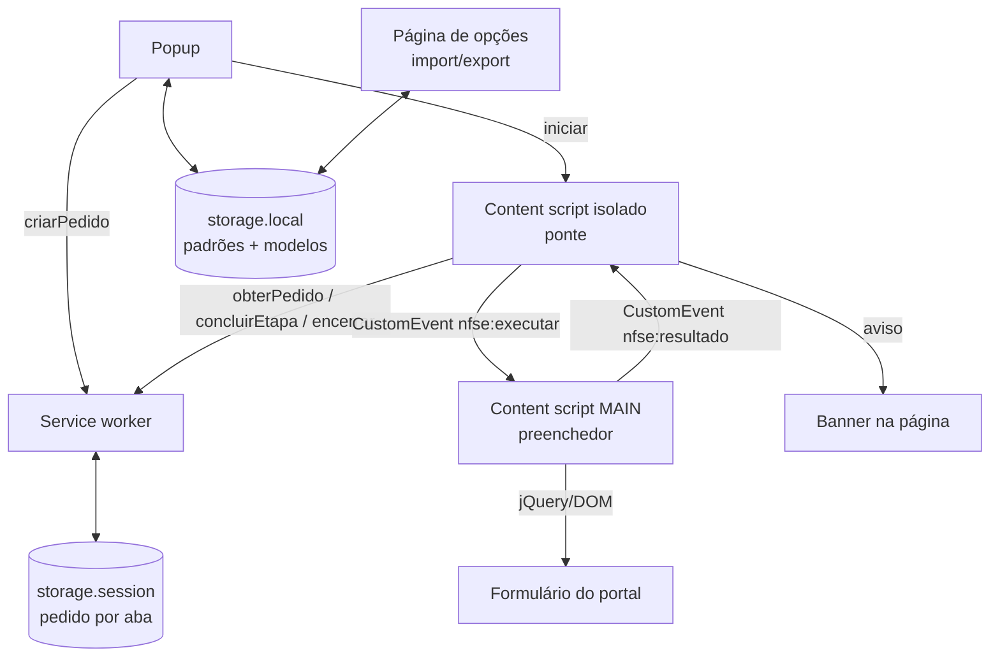

# Preenchedor v1 — Design

**Spec**: `.specs/features/2026-11-09-preenchedor-v1/spec.md`
**Status**: Approved

---

## Decisão central: onde roda o preenchimento

O portal usa jQuery + Chosen + Select2 (AJAX) + jquery.mask. No mapeamento, o que funcionou foi chamar o jQuery da própria página (`val().trigger('chosen:updated').trigger('change')`) e digitar tecla a tecla. Content scripts comuns rodam num mundo isolado e não enxergam `window.jQuery`.

| Abordagem | Como | Prós | Contras |
|---|---|---|---|
| **A. Preenchedor no mundo MAIN** (recomendada) | Content script declarado com `"world": "MAIN"` contém toda a lógica de preenchimento e usa o jQuery da página. Um content script isolado faz só a ponte com a extensão (pedido/resultado) via `CustomEvent`. | Mesmo mecanismo validado no mapeamento; menos idas e vindas entre mundos. | Código no MAIN não acessa `chrome.*` (resolvido pela ponte); a página poderia, em tese, ver os eventos da ponte — aceitável, os dados são da própria nota que vai para a página. |
| B. Tudo no mundo isolado simulando UI | Cliques e eventos sintéticos em Chosen/Select2 | Sem ponte | Chosen/Select2/mask reagem a sequências de eventos específicas; não validado; mais frágil. |
| C. `chrome.debugger` com teclas reais | Input real via DevTools Protocol | Fiel ao usuário | Permissão `debugger` gera aviso assustador na instalação e na tela ("está depurando este navegador"); ruim para Web Store. |

**Ponto a validar no primeiro task de integração:** digitação mascarada (data, CNPJ, valor, alíquota) via MAIN — hipótese: `$(el).val(x).trigger('input').trigger('keyup').trigger('change').trigger('blur')` aplica a máscara e dispara a lógica da página. Se falhar, plano B: inserir caractere a caractere disparando `keydown/keypress/input/keyup` por caractere.

---

## Visão Geral



Sequência de um preenchimento:

1. Popup valida a nota atual e envia `criarPedido` ao SW com o `tabId`; o SW grava `pedido:<tabId> = { dados, etapaEsperada: 'pessoas', criadoEm }`.
2. Popup manda `iniciar` para a aba; a ponte pede o pedido ao SW, confere a etapa pela URL e dispara `nfse:executar` com `{ etapa, dados }`.
3. O preenchedor executa a etapa e responde `nfse:resultado` com `{ ok: true, proxima, municipioEmitente? }` imediatamente antes de clicar em Avançar, ou `{ ok: false, campo, motivo }`.
4. A ponte grava `etapaEsperada = proxima` (via SW) e, na próxima página, repete o passo 2 automaticamente ao carregar.
5. Na Conferência: banner de sucesso e o pedido é apagado. Em erro: banner com etapa + campo e o pedido é apagado.

A etapa esperada evita loop (spec: casos limite). O SW apaga o pedido em `tabs.onRemoved`, em `tabs.onUpdated` quando a URL sai de `/EmissorNacional/DPS/` e quando `criadoEm` passa de 10 min.

---

## Componentes

### `src/dominio/` — regras puras (TDD)
- `tipos.ts`: `DadosNota`, `Modelo`, `Padroes`, `Pedido`, `Etapa = 'pessoas' | 'servico' | 'valores' | 'conferencia'`.
- `validacao.ts`: `validarNota(d)`, `validarModelo(m)`, `validarPadroes(p)` → lista de `{ campo, mensagem }`. Inclui DV de CNPJ, data dd/mm/aaaa, `Nome/UF`.
- `formatos.ts`: `parseMoedaBR('1.234,56') → 123456` (centavos), `centavosParaDigitos`, `formatarCodigoTributacao('010101') → '01.01.01'`, `apenasDigitos`, `hojeBR()`.
- `etapas.ts`: `etapaDaUrl(url)` (ignora query), `proximaEtapa(e)`.
- `importacao.ts`: `exportar(padroes, modelos)`, `analisarImportacao(json)` → `{ ok, padroes?, modelos, conflitos }` ou erro.

### `src/armazenamento/` — `chrome.storage.local` (TDD com fake de storage)
- `repositorio.ts`: `lerPadroes()` (com defaults NFSE-15), `salvarPadroes()`, `listarModelos()`, `salvarModelo()`, `excluirModelo()`. Chaves: `padroes`, `modelos` (array).

### `src/portal/`
- `seletores.ts`: **único** lugar com seletores e textos do portal (tabela do `docs/mapeamento-portal.md`).
- `acoes.ts` (MAIN): primitivas `esperar(seletor, cond, 15s)`, `marcarRadio(name, valor)` (clica no `label`), `selecionarChosen(id, valor)`, `selecionarSelect2Ajax(id, termo, textoExato | prefixo)`, `digitarMascarado(id, texto)`, `clicarAvancar()`. Cada falha lança `FalhaCampo(campo)`.
- `etapa-pessoas.ts`, `etapa-servico.ts`, `etapa-valores.ts` (MAIN): sequência da spec NFSE-04/05/06 usando só `acoes` + `seletores`. Recebem as ações por parâmetro → testáveis com ações falsas (ordem e argumentos).
- `codigo-complementar.ts`: detecta `CodigoComplementarMunicipalObrigatorio` = `true` (sem diferenciar maiúsculas; a página usa `false` minúsculo) (NFSE-09).

### `src/content/`
- `ponte.ts` (isolado): fala com o SW e o MAIN, mostra banners (shadow DOM, sem CSS do portal).
- `preenchedor.ts` (MAIN): escuta `nfse:executar`, chama a etapa, responde `nfse:resultado`.

### `src/background/sw.ts`
Pedidos por aba em `storage.session` (só o SW acessa; content scripts não têm acesso por padrão), limpeza por aba/tempo/URL.

### `src/popup/` — painel lateral, HTML + TS sem framework

> **Decisão (2026-11-09, pedido do dev):** a interface abre no **painel lateral do Chrome** (`chrome.sidePanel`, Chrome 116+), não num popup. O ícone abre o painel (`setPanelBehavior({ openPanelOnActionClick: true })` no SW). Consequências: o painel continua aberto entre abas e acompanha a aba ativa (`tabs.onActivated`/`onUpdated`) para habilitar o Preencher (NFSE-02); não fecha após Preencher; perguntas (apelido, substituir, excluir) usam `<dialog>` no próprio painel, porque `prompt()`/`confirm()` não têm suporte confirmado no painel lateral. A pasta continua `src/popup` (scope de commit `popup`).

> **Visual (2026-11-09):** segue o mockup do dev ("Popup — repaginado"): tema escuro por padrão (variante clara pelo sistema), cards por seção, ícones SVG inline, rodapé fixo com Salvar padrão/Preencher. Sem biblioteca de componentes nem Tailwind: CSS próprio em `src/estilo/tema.css`, compartilhado com a página de opções; fontes do sistema (nada carregado de fora). shadcn/React foi considerado e descartado — exigiria React para um formulário.

Formulário da nota, seleção de modelo, Salvar como modelo / Atualizar / Excluir, Salvar como padrão, Preencher, "Abrir emissão de NFS-e", link "Importar/Exportar".

### `src/opcoes/` — página de opções
**Importar/exportar ficam aqui, não no popup**: no Chrome o seletor de arquivo fecha o popup antes de o arquivo ser lido. Export baixa o JSON; import lê o arquivo, pergunta conflitos (`confirm`) e a caixa "Importar também os padrões".

---

## Modelos de dados

```ts
type Regime = 1 | 2 | 3;

interface DadosNota {
  cnpjTomador: string;        // 14 dígitos
  emailTomador?: string;
  telefoneTomador?: string;
  valorCentavos: number;      // > 0
  descricao: string;
  dataCompetencia: string;    // dd/mm/aaaa
  municipio?: string;         // 'Nome/UF'; vazio = do emitente
  codigoTributacao: string;   // 6 dígitos
  nbs: string;                // 9 dígitos
  regime: Regime;
  aliquotaCentesimos: number; // 2,01 → 201
}

interface Modelo {            // NFSE-10: sem data, regime e alíquota
  apelido: string;
  cnpjTomador: string; emailTomador?: string; telefoneTomador?: string;
  valorCentavos?: number; descricao?: string; municipio?: string;
  codigoTributacao: string; nbs: string;
}

interface Padroes {
  codigoTributacao: string; nbs: string; regime: Regime; aliquotaCentesimos: number;
  descricao?: string; municipio?: string;
}

interface Pedido { dados: DadosNota; etapaEsperada: Etapa; criadoEm: number; municipioEmitente?: string; aguardandoManual?: boolean; }

interface ArquivoExportado { versao: 1; padroes: Padroes; modelos: Modelo[]; }
```

---

## Manifest (resumo)

- `permissions`: `storage`, `tabs`, `sidePanel`; `minimum_chrome_version`: 116
- `host_permissions`: `https://www.nfse.gov.br/EmissorNacional/*`
- `content_scripts`: `ponte.js` (isolado) e `preenchedor.js` (`"world": "MAIN"`), ambos em `/EmissorNacional/DPS/*`, `run_at: document_idle`
- `background.service_worker`: `sw.js` (module)
- `action` (sem popup) + `side_panel.default_path` = `popup/index.html`, `options_page`
- Sem `scripting` (os dois scripts são declarados) e sem `activeTab`.

Build: Vite com múltiplas entradas (popup, opções, SW como módulo; `ponte` e `preenchedor` como IIFE, porque content scripts não carregam ES modules) e cópia do `manifest.json`. Sem plugin CRX para manter o build simples.

---

## Testes

| Camada | Como | Requisitos |
|---|---|---|
| dominio | Vitest puro | NFSE-03, 15, 17, 18, 19 |
| armazenamento | Vitest + fake em memória de `chrome.storage` | NFSE-10..16 |
| etapas | Vitest com ações falsas: verifica ordem/argumentos | NFSE-04..07, 09 |
| seletores | Vitest + jsdom carregando `tests/fixtures/*.html` (anonimizados): todo seletor de `seletores.ts` existe na fixture da sua etapa | proteção contra quebra |
| SW / ponte | Vitest com fakes de `chrome.*` para a máquina de estados do pedido | NFSE-07, 08, casos limite |
| ponta a ponta | Manual no portal de produção, até a Conferência (gera rascunho) | todos |

---

## Reuse Validation

**Componentes reusáveis identificados:** nenhum (projeto greenfield).
**Padrões reusáveis identificados:** jQuery/Chosen/Select2 da própria página (via mundo MAIN) em vez de reimplementar interação.
**Áreas exploradas SEM reuso:** frameworks de UI para o popup (React/Preact) — descartados; o popup é um formulário e não justifica a dependência.
**Áreas NÃO exploradas:** (vazio)

## Riscos tratados (CONCERNS.md)

- Quebra de seletor → `seletores.ts` único + teste com fixtures + erro com nome do campo.
- Recarga entre etapas → pedido no SW com etapa esperada.
- Select2 parcial → seleção por texto exato (município) e por prefixo do código formatado (`01.01.01 - `).
- Máscara via MAIN não validada → primeiro task de integração é um spike com plano B definido.
